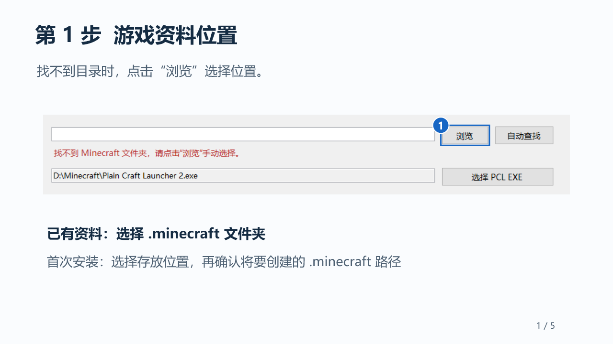
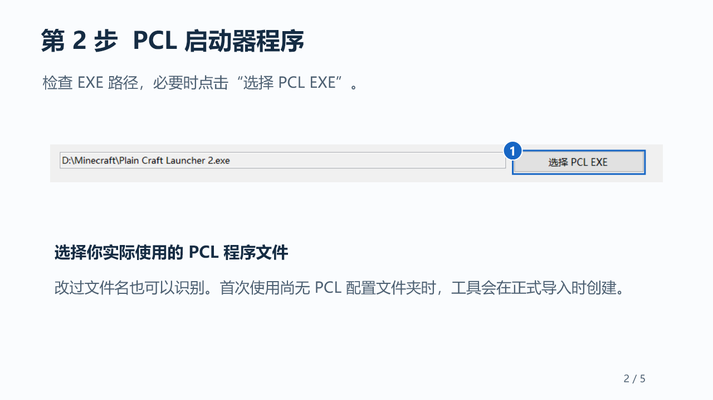
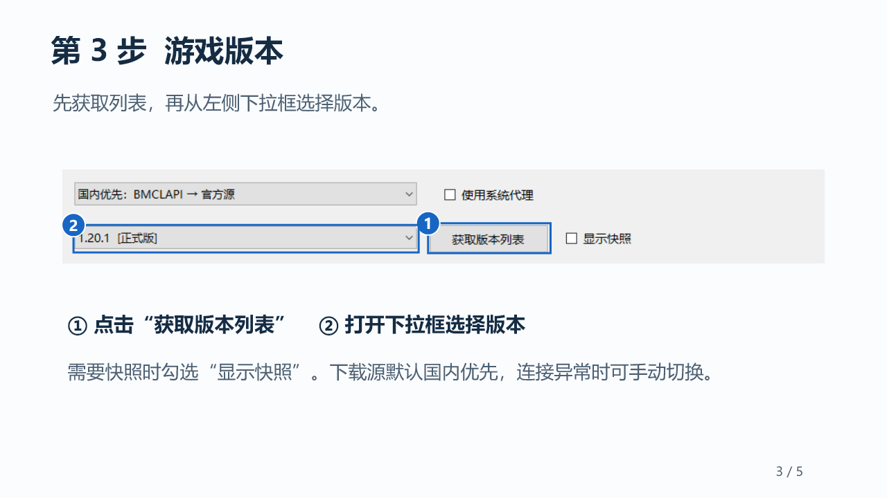
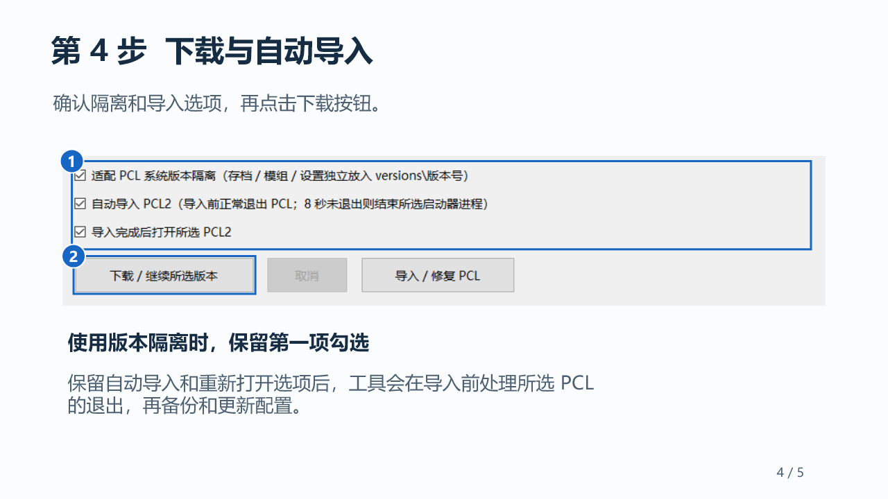
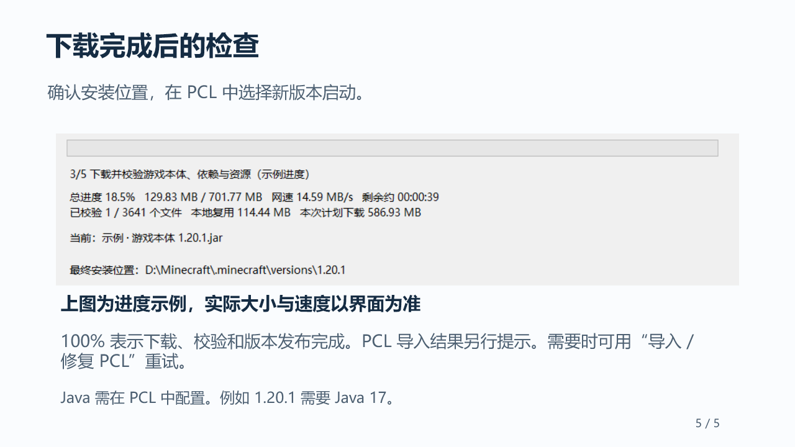

# MinecraftDownloader

Windows 上的 Minecraft Java 版原版下载助手。选择版本后，下载游戏本体、Windows x64 依赖与资源，并适配 PCL2 的版本隔离和游戏目录。

**[下载 EXE](https://github.com/PaytonJu/MinecraftDownloader/raw/refs/heads/main/downloads/MinecraftDownloader.exe)** · **[下载使用教程 PPT](https://github.com/PaytonJu/MinecraftDownloader/raw/refs/heads/main/docs/usage-guide.pptx)** · [反馈问题](https://github.com/PaytonJu/MinecraftDownloader/issues)

## 能做什么

- 原版正式版与快照下载。
- BMCLAPI 国内镜像优先，支持切换至 Mojang 官方源。
- 下载前汇总资源总量，实时显示进度、KB/s 或 MB/s、预计剩余时间与当前阶段。
- 校验文件大小及 SHA-1，继续下载时复用完整文件。
- 检测实际存在的游戏目录。首次安装时，先选择并确认新目录。
- 识别改名后的 PCL EXE，适配版本隔离，自动导入与重新打开所选 PCL。

适用于 Windows 10/11 x64，运行环境为 .NET Framework 4.8。不需要安装 Python、Node.js 或 .NET SDK。

## 分步使用

### 第 1 步：确认游戏目录

双击 EXE。绿色提示表示目录存在，游戏文件会在下载或导入时校验。

如果出现红色“找不到 Minecraft 文件夹”，点击右上角 **浏览**，选择已有 `.minecraft`，或选择首次安装位置。首次创建目录会再次显示完整路径并要求确认。



### 第 2 步：确认 PCL 程序

查看第二个路径框。没有找到正确的 PCL 时，点击 **选择 PCL EXE**，选择你实际使用的启动器。文件改名后仍可通过内嵌产品信息或程序集名称识别。

首次使用 PCL，没有现成 `PCL` 配置目录也可以。工具只在正式导入时，在所选 EXE 的同级目录创建所需配置。



### 第 3 步：获取列表并选择版本

点击 **获取版本列表**，再从左侧下拉框选择版本。需要快照时，勾选 **显示快照**。默认使用 BMCLAPI 国内源，国内源连续失败时会暂时优先官方源。



### 第 4 步：确认选项并开始下载

使用 PCL 版本隔离时，保留 **适配 PCL 系统版本隔离**。

需要自动导入并打开启动器时，保留 **自动导入 PCL2** 和 **导入完成后打开所选 PCL2**。然后点击 **下载 / 继续所选版本**，核对版本与目标路径。



### 第 5 步：观察进度

工具先获取版本清单与资源索引，随后显示准确总量与按字节统计的总进度。大文件传输过程中也会更新进度。连接等待、重试和切换来源会写入下方日志。

下载完成后，工具先校验版本。导入时会请求所选 PCL 正常退出，8 秒未退出则结束该启动器进程，再备份并更新配置。只按所选 EXE 的完整路径处理启动器进程。Java 游戏进程保持运行。导入完成后，按勾选项重新打开同一 PCL。



### 第 6 步：在 PCL 中启动

在 PCL 中选择新版本，安装或选择对应 Java，再启动游戏。例如 Minecraft 1.20.1 需要 Java 17。本工具不安装 Java。

## 文件放在哪里

```text
.minecraft/
├─ versions/
│  └─ 版本号/
│     ├─ 版本号.json
│     ├─ 版本号.jar
│     ├─ PCL/Setup.ini
│     ├─ saves/           # 启用隔离时的存档
│     └─ mods/            # 启用隔离时的模组目录
├─ libraries/            # 共用依赖
├─ assets/               # 共用资源
├─ .download-staging/    # 尚未完成的下载
└─ .download-helper-backups/  # 导入前的配置备份
```

尚未完成的版本不会加入正式 `versions`。已有同名版本目录时，工具拒绝覆盖。取消后可重新下载同一版本，复用已完成且校验正确的文件。未完成的单个文件重新下载。

## 当前支持范围

支持采用现代 Mojang 下载元数据的独立原版客户端。暂不支持 Forge、Fabric、NeoForge、OptiFine、整合包安装，以及部分旧版本元数据。

游戏启动与账号登录由 PCL 完成。此仓库只发布下载助手自身的源码和程序。

## 从源码构建

在 Windows PowerShell 中运行：

```powershell
powershell -ExecutionPolicy Bypass -File .\build.ps1
```

脚本使用 Windows .NET Framework 的 C# 编译器，生成仓库根目录下的 `MinecraftDownloader.exe`。

运行离线测试：

```powershell
$p = Start-Process .\MinecraftDownloader.exe --self-test -Wait -PassThru
$p.ExitCode
Get-Content .\self-test-result.txt
Get-Content .\regression-test-result.txt
Get-Content .\discovery-lifecycle-test-result.txt
```

离线测试使用临时文件、模拟进程和仅用于读取 EXE 元数据的测试程序，不需要安装 PCL，也不会结束实际 PCL 进程。

## 常见问题

**删掉目录后还显示“识别成功”？**

2.1 版找不到目录时会清空自动检测结果，并显示红色提示。目录存在仅表示路径存在，不代表游戏已完整安装。

**找到了 PCL，但导入失败？**

确认选择的是实际使用的 EXE。如果工具权限不足以结束该 PCL，请手动退出启动器，再点击“导入 / 修复 PCL”。

**网速为 0 或连接反复重试？**

尝试“仅 Mojang 官方源”或“仅 BMCLAPI 国内镜像”。需要代理时勾选“使用系统代理”。日志保存在 `%LOCALAPPDATA%\MinecraftFolderDownloader\logs`。提交问题前请检查并删去日志中的个人路径或账号信息。

## 致谢与许可证

国内镜像由 **BMCLAPI / bangbang93** 提供：[API 文档](https://bmclapidoc.bangbang93.com/)。

PCL 目录与隔离配置参考其公开源码：[PCL](https://github.com/Meloong-Git/PCL)。本项目独立开发，与 PCL、Mojang 和 Microsoft 无隶属关系。

本项目采用 [MIT License](LICENSE)。Minecraft 游戏文件、PCL 及其他第三方内容遵循各自的许可。
